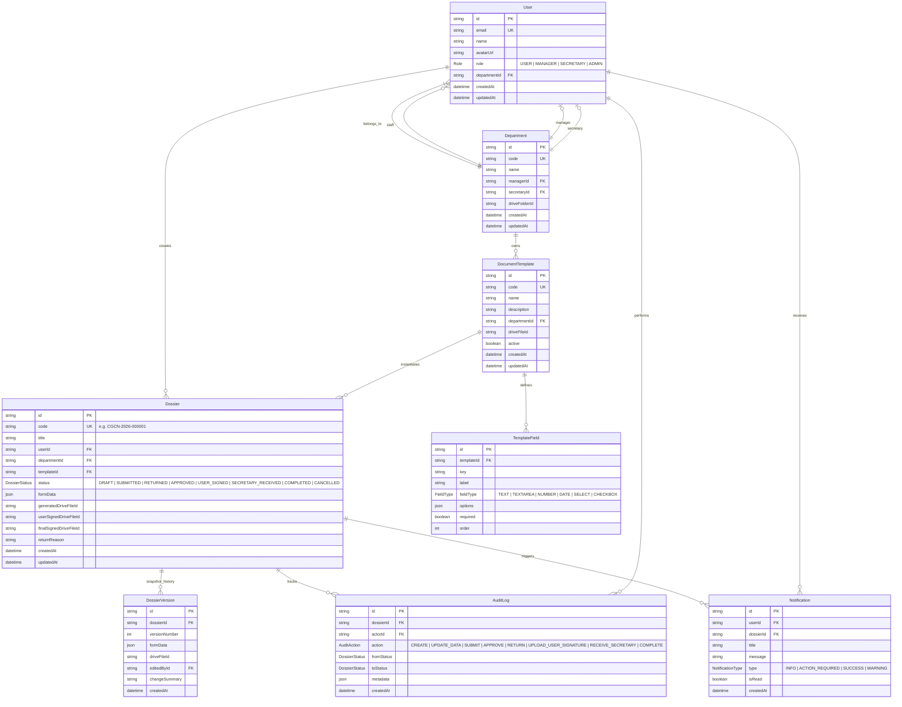
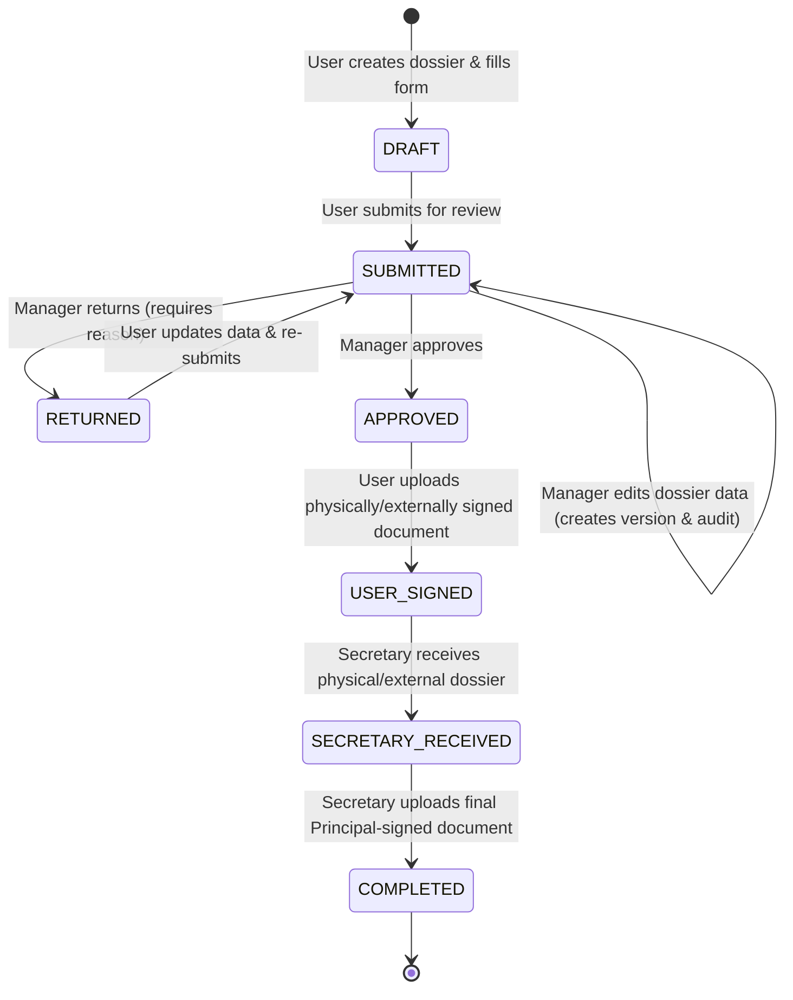

# Document Workflow Management System - Requirements & Architecture Document

## Executive Summary
This document specifies the architecture, data models, workflow state transitions, security model, and implementation roadmap for the Document Workflow Management System built for organizational document creation, review, physical signing, and Google Drive archival.

---

## A. Architecture Overview

```
┌─────────────────────────────────────────────────────────────────────────┐
│                           Client Browser                                │
│          (Next.js App Router + React + Tailwind CSS + shadcn/ui)         │
└────────────────────────────────────┬────────────────────────────────────┘
                                     │ HTTPS
                                     ▼
┌─────────────────────────────────────────────────────────────────────────┐
│                      Next.js Backend Server                             │
│  - Authentication & RBAC Guard (NextAuth + Role/Dept Validation)       │
│  - Workflow State Machine Engine (Server-side transition validations)   │
│  - Document Generator (docxtemplater / docx parser)                     │
│  - Audit Logger & In-App Notification Service                          │
└──────────┬─────────────────────────┬─────────────────────────┬──────────┘
           │ Prisma ORM              │ Google Drive API        │ Gmail API / SMTP
           ▼                         ▼                         ▼
┌──────────────────────┐  ┌──────────────────────┐  ┌──────────────────────┐
│  PostgreSQL Database │  │  Google Drive Cloud  │  │  Email Notifications │
│ (Source of Truth for │  │   (Document File     │  │  (Automated emails   │
│  Users, Workflow,    │  │   Storage Layer)     │  │   to Users/Managers/ │
│  Audit Logs & Forms) │  │                      │  │   Secretaries)       │
└──────────────────────┘  └──────────────────────┘  └──────────────────────┘
```

### Key Architectural Principles:
1. **PostgreSQL as Single Source of Truth**: All business metadata, workflow state history, form submissions, versions, user roles, and audit records reside in PostgreSQL.
2. **Google Drive as Binary Storage**: DOCX templates, generated docx files, signed PDFs/images are stored directly in Google Drive. Database references file IDs only.
3. **Server-Owned Authorization**: All workflow state transitions (Approve, Return, Upload Signatures, Complete) are strictly guarded on the backend. Frontend UI components render contextually but never authorize state changes.
4. **Immutable Audit Trails**: Every state change, data edit by managers, document submission, and upload generates an audit log record with timestamps, user IDs, previous state, new state, and payload diffs.
5. **Multi-Channel Notifications**: Important state changes automatically spawn both database (in-app UI) and email notifications (to assigned managers, secretaries, or submitters).

---

## B. Database Schema & Entity Relationship Diagram (ERD)



---

## C. Workflow State Machine

### State Flow Diagram:



### State Definitions & Guards:

| State | Allowed Transitions | Allowed Roles | System Actions |
|---|---|---|---|
| `DRAFT` | `SUBMITTED` | `USER`, `ADMIN` | DOCX generation, preview enabled |
| `SUBMITTED` | `APPROVED`, `RETURNED`, `SUBMITTED` (edit) | `MANAGER`, `ADMIN` | Email notification to Manager |
| `RETURNED` | `SUBMITTED` | `USER` (Author), `ADMIN` | User updates form data, re-generates DOCX |
| `APPROVED` | `USER_SIGNED` | `USER` (Author), `ADMIN` | Email notification to User with approved DOCX download link |
| `USER_SIGNED` | `SECRETARY_RECEIVED` | `SECRETARY`, `ADMIN` | Email notification to Secretary, file uploaded to Drive |
| `SECRETARY_RECEIVED` | `COMPLETED` | `SECRETARY`, `ADMIN` | Physical dossier handed over to Principal |
| `COMPLETED` | None (Terminal) | System | Final signed document archived in Drive, email to User |

---

## D. Project Folder Structure

```
/
├── prisma/
│   ├── schema.prisma
│   └── seed.ts
├── public/
├── src/
│   ├── app/
│   │   ├── layout.tsx
│   │   ├── page.tsx
│   │   ├── (auth)/
│   │   │   └── login/
│   │   ├── (dashboard)/
│   │   │   ├── layout.tsx
│   │   │   ├── dashboard/
│   │   │   │   └── page.tsx
│   │   │   ├── dossiers/
│   │   │   │   ├── page.tsx
│   │   │   │   ├── new/
│   │   │   │   │   └── page.tsx
│   │   │   │   └── [id]/
│   │   │   │       └── page.tsx
│   │   │   ├── manager/
│   │   │   │   └── page.tsx
│   │   │   ├── secretary/
│   │   │   │   └── page.tsx
│   │   │   └── admin/
│   │   │       └── page.tsx
│   │   └── api/
│   │       ├── auth/[...nextauth]/route.ts
│   │       ├── dossiers/[id]/transition/route.ts
│   │       ├── dossiers/[id]/preview/route.ts
│   │       ├── drive/upload/route.ts
│   │       └── notifications/route.ts
│   ├── components/
│   │   ├── ui/ (shadcn/ui primitives)
│   │   ├── layout/ (header, sidebar, nav)
│   │   ├── dossiers/ (form builders, state badges, version viewer)
│   │   ├── manager/ (approval dialog, return dialog, edit modal)
│   │   ├── secretary/ (reception checklist, final upload)
│   │   └── workflow/ (timeline, audit log viewer)
│   ├── lib/
│   │   ├── prisma.ts
│   │   ├── auth.ts
│   │   ├── rbac.ts
│   │   ├── drive.ts
│   │   ├── gmail.ts
│   │   ├── docx.ts
│   │   └── workflow/
│   │       ├── state-machine.ts
│   │       └── audit.ts
│   ├── types/
│   │   └── index.ts
├── REQUIREMENTS.md
├── package.json
├── tsconfig.json
└── tailwind.config.js
```

---

## E. Phased Implementation Roadmap

### Phase 1: Foundation (Bootstrap, DB, Auth & RBAC)
- Initialize Next.js 14+ App Router project structure with TypeScript, Tailwind CSS, shadcn/ui.
- Configure PostgreSQL database connection and Prisma ORM setup.
- Define Prisma schema with User, Department, DocumentTemplate, TemplateField, Dossier, DossierVersion, AuditLog, Notification models.
- Implement Database Seed Script (`prisma/seed.ts`) with departments, roles (USER, MANAGER, SECRETARY, ADMIN), users, and initial templates.
- Implement NextAuth with Google OAuth provider & local fallback/role session handling.
- Establish backend RBAC helpers (`lib/rbac.ts`).

### Phase 2: Departments, Templates & Dossier Form Management
- Department selection API & UI.
- Template registry & field definition API.
- Dynamic Form Generator component based on `TemplateField` configurations (text, date, select, checkbox, textarea).
- Dossier creation & draft management endpoints.

### Phase 3: DOCX Generation, Preview & Drive Storage
- DOCX parsing & template filling service (`lib/docx.ts`).
- Server-side DOCX generation from `formData`.
- Document preview component & download handler.
- Integration with Google Drive API for storing generated documents.

### Phase 4: Workflow State Machine, Manager Actions & Audit Logging
- Server-side Workflow State Machine engine (`lib/workflow/state-machine.ts`).
- Manager Dashboard showing pending reviews.
- Manager approval workflow.
- Manager return workflow with required reason payload.
- Manager edit-in-place workflow with automatic version snapshot & audit log creation.

### Phase 5: Notifications System
- In-App notification system with real-time/polling updates and read states.
- Email notification trigger integration via Gmail API/Nodemailer on key status changes.

### Phase 6: Physical Signing, Secretary Workflow & Completion Archival
- Submitter signed document upload handler (PDF/DOCX to Google Drive).
- Secretary dashboard & dossier intake workflow.
- Final Principal signed document upload by Secretary.
- Automatic dossier completion, user notification, and Google Drive archival.
