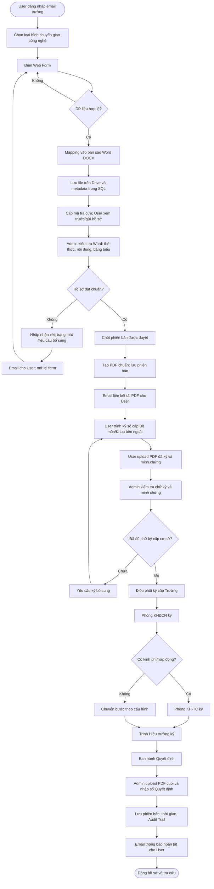
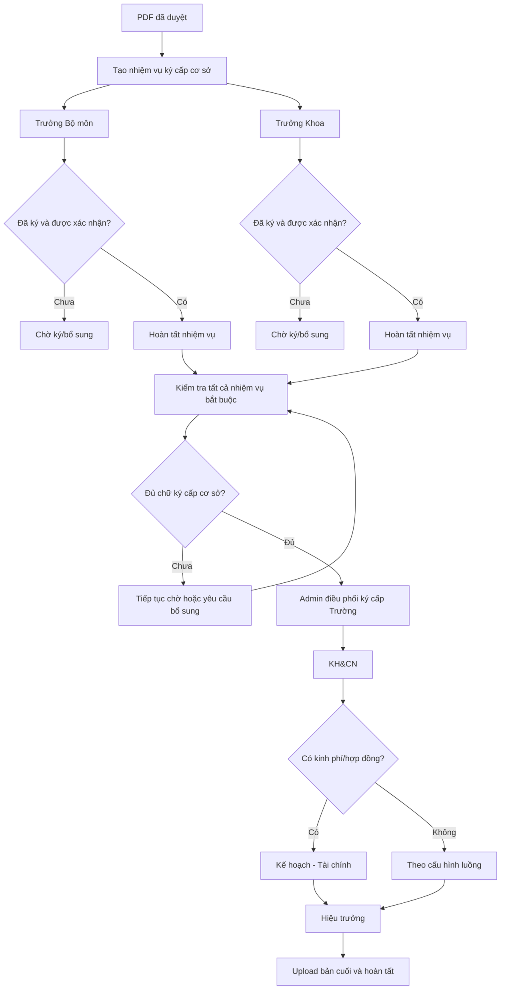
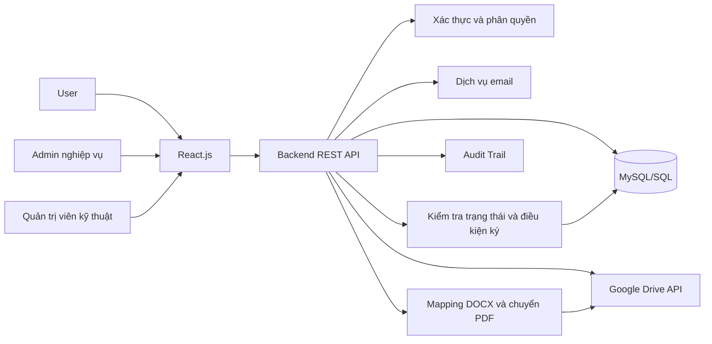
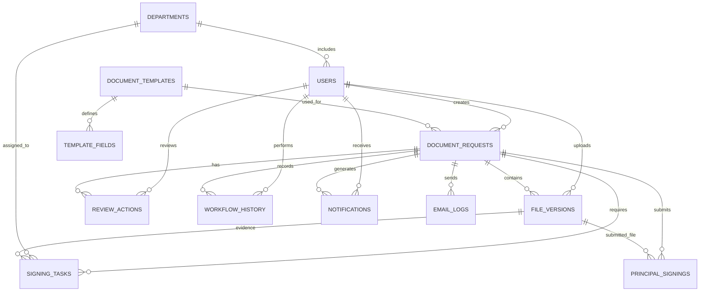

# Đặc tả nghiệp vụ và thiết kế cơ sở dữ liệu
## Hệ thống quản lý hồ sơ chuyển giao công nghệ và quy trình trình ký số

- **Phiên bản:** 2.0
- **Frontend:** React.js
- **Backend:** REST API (công nghệ cụ thể lựa chọn khi triển khai)
- **Cơ sở dữ liệu:** MySQL 8.0+ (có thể điều chỉnh cho hệ quản trị SQL khác)
- **Lưu trữ file:** Google Drive API
- **Thông báo:** Email trường/Gmail và thông báo trong hệ thống

---

## 1. Mục tiêu và phạm vi

Xây dựng hệ thống giúp cán bộ, giảng viên lập hồ sơ chuyển giao công nghệ bằng biểu mẫu điện tử; tự động ánh xạ dữ liệu vào biểu mẫu Word chuẩn của trường; tiền kiểm, duyệt thể thức; chuyển hồ sơ qua các giai đoạn ký số; lưu trữ văn bản cuối cùng và theo dõi toàn bộ lịch sử xử lý.

Hệ thống có các mục tiêu:
- Giảm nhập liệu thủ công và sai sót khi lập hồ sơ.
- Giữ nguyên biểu mẫu Word chuẩn của trường.
- Tạo PDF sau khi hồ sơ được duyệt để sử dụng trong quy trình ký số.
- Cho phép các phòng ban ký độc lập hoặc theo thứ tự linh hoạt trong phạm vi được cấu hình.
- Chỉ chuyển lên Hiệu trưởng khi tất cả chữ ký bắt buộc ở các bước trước đã được xác nhận.
- Lưu file, phiên bản, số Quyết định và dấu thời gian để tra cứu.
- Cho phép User theo dõi tiến độ và nhận thông báo khi cần sửa, khi hồ sơ được duyệt và khi hoàn tất.

## 2. Vai trò và quyền hạn

### 2.1. User — Cán bộ/giảng viên
- Đăng nhập bằng email trường.
- Chọn loại hình chuyển giao công nghệ và biểu mẫu tương ứng.
- Điền Web Form; xem trước dữ liệu đã ánh xạ vào file Word.
- Lưu nháp, gửi hồ sơ để Admin tiền kiểm.
- Nhận yêu cầu chỉnh sửa và cập nhật form theo nhận xét.
- Sau khi hồ sơ hợp lệ, tải PDF chuẩn về để thực hiện ký số cấp Bộ môn/Khoa bên ngoài hệ thống.
- Tải lên PDF đã ký và các tài liệu/sản phẩm minh chứng liên quan.
- Theo dõi từng mốc xử lý, tải file được phép truy cập và nhận email hoàn tất.

### 2.2. Admin nghiệp vụ — Cán bộ tiền kiểm/điều phối (ví dụ cô Trúc)
- Xem hồ sơ đã gửi và tải file Word để kiểm tra thể thức, nội dung, bảng biểu.
- Đánh dấu **Chưa duyệt/Yêu cầu bổ sung**, nhập nhận xét cụ thể hoặc đánh dấu **Duyệt hợp lệ**.
- Khi duyệt, chốt phiên bản dữ liệu đã được kiểm tra; hệ thống tạo PDF và gửi thông báo cho User.
- Kiểm tra PDF đã ký cấp Bộ môn/Khoa và các file minh chứng.
- Điều phối các bước ký số nội bộ cấp Trường: Phòng KH&CN, Phòng Kế hoạch - Tài chính (nếu phát sinh kinh phí/hợp đồng) và Ban Giám hiệu/Hiệu trưởng.
- Chỉ xác nhận đủ điều kiện trình Hiệu trưởng khi tất cả nhiệm vụ ký bắt buộc đã hoàn thành.
- Upload bản PDF hoàn tất, nhập số Quyết định và xác nhận đóng hồ sơ.
- Theo dõi nhật ký và lịch sử phiên bản.

> Trong tài liệu này, “Admin nghiệp vụ” là người xử lý hồ sơ (có thể là cô Trúc). Nếu trường có quản trị viên kỹ thuật riêng, phải tạo vai trò riêng; không mặc định quản trị viên kỹ thuật có quyền duyệt nghiệp vụ.

### 2.3. Quản trị viên kỹ thuật (tùy chọn)
- Quản lý tài khoản, vai trò, cấu hình biểu mẫu, quyền tích hợp Google Drive và email.
- Theo dõi hoạt động kỹ thuật và cấu hình hệ thống.
- Không tự động có quyền phê duyệt hồ sơ nếu chưa được cấp quyền nghiệp vụ.

### 2.4. Người ký bên ngoài hệ thống
Trưởng Bộ môn, Trưởng Khoa, lãnh đạo Phòng KH&CN, Phòng Kế hoạch - Tài chính và Hiệu trưởng có thể ký trên phần mềm ký số/email chuyên dụng ngoài website. Website ghi nhận file đã ký, người xác nhận và thời gian; nếu yêu cầu xác thực chữ ký số, backend phải kiểm tra bằng công cụ/dịch vụ phù hợp.

## 3. Quy trình nghiệp vụ

### Bước 1 — Khởi tạo và điền thông tin (User)
1. User đăng nhập bằng email trường.
2. Chọn loại hình chuyển giao công nghệ.
3. Hệ thống hiển thị Web Form theo biểu mẫu đã cấu hình.
4. User điền thông tin như họ tên, MSCB, ngày sinh, đơn vị, thông tin chuyển giao và các trường riêng của biểu mẫu.
5. Backend xác thực trường bắt buộc và ánh xạ dữ liệu vào các biến trong file Word `.docx`.
6. Hệ thống tạo hồ sơ, cấp mã tra cứu định danh, lưu dữ liệu và file trên Google Drive, đồng thời lưu metadata/trạng thái trong SQL.
7. User xem trước, lưu nháp hoặc gửi hồ sơ.

**Nguyên tắc:** Không chỉnh sửa file mẫu gốc. Mỗi hồ sơ dùng một bản sao riêng; lưu dữ liệu form theo thời điểm gửi để có thể truy vết.

### Bước 2 — Tiền kiểm hồ sơ bản thảo (Admin nghiệp vụ)
1. Admin mở hồ sơ, xem dữ liệu và tải file Word đã mapping về để kiểm tra thể thức, nội dung và bảng biểu.
2. Nếu có sai sót:
   - Admin chọn **Chưa duyệt/Yêu cầu bổ sung**.
   - Nhập nhận xét cụ thể.
   - Hệ thống lưu lịch sử, gửi email cho User và mở lại form để chỉnh sửa.
   - User cập nhật và gửi lại; hệ thống tạo phiên bản mới và chờ tiền kiểm lại.
3. Nếu hồ sơ đạt yêu cầu:
   - Admin chọn **Duyệt hợp lệ** cho đúng phiên bản đã kiểm tra.
   - Hệ thống ghi nhận người duyệt, thời gian và phiên bản.
   - Nội dung của phiên bản đã duyệt được khóa về mặt nghiệp vụ.
   - Backend tạo PDF từ bản Word đã duyệt, lưu thành phiên bản mới và gửi email cho User kèm liên kết tải file PDF được cấp quyền.

**Lưu ý:** Giữ lại file Word đã duyệt làm bản nguồn. PDF là bản dùng cho quy trình ký số; việc tạo PDF không tự nó xác minh chữ ký số.

### Bước 3 — Điều phối ký số cấp cơ sở (User)
1. User tải PDF chuẩn đã được duyệt.
2. User thực hiện ký số bên ngoài hệ thống theo yêu cầu của trường, ví dụ Trưởng Bộ môn/Trưởng Khoa ký trên phần mềm chuyên dụng.
3. User tải lại PDF đã ký lên hồ sơ, kèm các tệp tài liệu/sản phẩm minh chứng liên quan.
4. Hệ thống lưu các file upload thành phiên bản mới, ghi nhận thời gian, người tải và checksum nếu có.
5. Admin kiểm tra file, xác nhận các chữ ký cấp cơ sở và các tài liệu minh chứng đã đủ.

Nếu chữ ký Bộ môn/Khoa có thể thực hiện độc lập hoặc theo thứ tự linh hoạt, mỗi chữ ký được cấu hình thành một nhiệm vụ riêng. Không chuyển sang bước cấp Trường khi vẫn còn nhiệm vụ bắt buộc chưa được xác nhận.

### Bước 4 — Trình ký số cấp Trường và lưu trữ (Admin nghiệp vụ)
1. Admin tiếp nhận PDF đã có chữ ký cấp cơ sở.
2. Admin điều phối các nhiệm vụ ký cấp Trường theo cấu hình:
   - Phòng KH&CN ký.
   - Phòng Kế hoạch - Tài chính ký **nếu có phát sinh kinh phí/hợp đồng**.
   - Ban Giám hiệu/Hiệu trưởng ký phê duyệt.
3. Các nhiệm vụ có thể được cấu hình ký tuần tự hoặc độc lập trong phạm vi quy định của trường; điều kiện tiên quyết và thứ tự bắt buộc phải được cấu hình rõ.
4. Sau khi Hiệu trưởng ký và ban hành Quyết định chuyển giao công nghệ, Admin tải PDF hoàn tất lên hệ thống.
5. Admin nhập số Quyết định, ngày ban hành và thông tin cần thiết.
6. Hệ thống lưu phiên bản cuối, ghi nhận thời gian, người upload, số Quyết định và chuyển hồ sơ sang **Hoàn tất**.
7. Hệ thống gửi email cho User thông báo hồ sơ đã hoàn tất và cung cấp liên kết tải file theo quyền được cấp.

### Bước 5 — Theo dõi trạng thái và nhật ký xử lý (Audit Trail)
User và Admin được xem tiến độ theo quyền:
- Mới tạo/Nháp.
- Mới nộp/Chờ tiền kiểm.
- Yêu cầu bổ sung.
- Đã duyệt thể thức.
- Đang ký số cấp cơ sở.
- Chờ kiểm tra file đã ký cấp cơ sở.
- Đang trình ký cấp Trường.
- Chờ/đang trình Hiệu trưởng.
- Hoàn tất.
- Đã hủy (nếu được phép).

Nhật ký cần lưu thời gian, người thực hiện, hành động, trạng thái trước/sau, nhận xét và phiên bản file liên quan. Không cho người dùng thông thường sửa/xóa nhật ký.

## 4. Sơ đồ nghiệp vụ tổng thể



## 5. Sơ đồ nhiệm vụ ký linh hoạt

Mỗi nhiệm vụ ký được theo dõi riêng. Quy tắc có thể là độc lập hoặc có điều kiện phụ thuộc nhiệm vụ khác.



> Sơ đồ minh họa. Thứ tự thực tế phải được cấu hình theo quy định trường. Nếu một nhiệm vụ phụ thuộc nhiệm vụ khác, backend chỉ cho phép bắt đầu khi điều kiện phụ thuộc đã thỏa mãn.

## 6. Kiến trúc hệ thống



- Chỉ backend được giữ thông tin xác thực Google Drive; không đưa secret/token vào frontend.
- Backend phải kiểm tra quyền trên từng hồ sơ, file và thao tác.
- SQL lưu trạng thái, dữ liệu form, phiên bản, mã Drive và nhật ký; Drive lưu nội dung file.
- Link tải file phải được kiểm tra quyền hoặc cấp quyền có thời hạn; không đặt file hồ sơ ở chế độ công khai.
- Cần cơ chế retry/đối soát khi Drive, SQL hoặc email gặp lỗi.

## 7. ERD — Mô hình dữ liệu



## 8. Thiết kế cơ sở dữ liệu

### 8.1. `departments`
Danh mục phòng ban/đơn vị.
- `id`: khóa chính.
- `code`: mã duy nhất.
- `name`: tên phòng ban.
- `is_active`, `created_at`.

### 8.2. `users`
Tài khoản người dùng.
- `id`, `full_name`, `staff_code`, `date_of_birth`, `email`.
- `password_hash`: chỉ lưu mật khẩu đã băm.
- `role`: `ADMIN`, `REVIEWER`, `TEACHER`.
- `department_id`: đơn vị công tác.
- `is_active`, `email_verified_at`, `created_at`, `updated_at`.

### 8.3. `document_templates`
Biểu mẫu Word chuẩn.
- `id`, `name`, `description`.
- `drive_file_id`: ID file mẫu trên Google Drive.
- `is_active`, `created_by`, `created_at`, `updated_at`.

### 8.4. `template_fields`
Các biến và trường nhập liệu của từng biểu mẫu.
- `id`, `template_id`, `field_key`, `label`, `field_type`.
- `is_required`, `validation_rule` (JSON), `sort_order`.
- Ví dụ biến Word: `{{ho_ten}}`, `{{mscb}}`, `{{ngay_sinh}}`.

### 8.5. `document_requests`
Hồ sơ chuyển giao công nghệ.
- `id`, `request_code` (mã tra cứu duy nhất), `template_id`, `created_by`.
- `current_status`: trạng thái quy trình.
- `form_data` (JSON): snapshot dữ liệu tại thời điểm gửi.
- `current_file_version_id`: phiên bản file hiện hành.
- `decision_number`: số Quyết định, có thể NULL cho đến khi hoàn tất.
- `decision_date`: ngày ban hành Quyết định.
- `submitted_at`, `approved_at`, `completed_at`, `created_at`, `updated_at`.

### 8.6. `file_versions`
Lịch sử các file Word/PDF và minh chứng.
- `id`, `request_id`, `version_number`.
- `file_type`: `GENERATED_DOCX`, `APPROVED_DOCX`, `APPROVED_PDF`, `DEPARTMENT_SIGNED_PDF`, `EVIDENCE`, `FINAL_SIGNED_PDF`, `DECISION`.
- `drive_file_id`, `file_name`, `mime_type`.
- `uploaded_by`, `uploaded_at`, `checksum`.
- Ràng buộc duy nhất `(request_id, version_number)`.

### 8.7. `review_actions`
Lịch sử tiền kiểm.
- `id`, `request_id`, `reviewer_id`.
- `action`: `APPROVE` hoặc `REQUEST_CHANGES`.
- `comment`, `file_version_id`, `created_at`.

### 8.8. `signing_tasks`
Mỗi chữ ký/phòng ban là một nhiệm vụ độc lập.
- `id`, `request_id`, `department_id` (có thể mở rộng cho người ký cụ thể).
- `stage`: `DEPARTMENT` hoặc `UNIVERSITY`.
- `signer_label`: tên chức danh/người ký, ví dụ Trưởng Bộ môn, Trưởng Khoa, Phòng KH&CN, Phòng Kế hoạch - Tài chính, Hiệu trưởng.
- `is_required`: có bắt buộc không.
- `status`: `NOT_READY`, `PENDING`, `SIGNED`, `REJECTED`, `WAIVED`.
- `depends_on_task_id`: nhiệm vụ phải hoàn thành trước, nếu có.
- `signed_file_version_id`: file bằng chứng đã ký.
- `confirmed_by`, `confirmed_at`, `note`, `created_at`, `updated_at`.

Các phòng ban có thể ký độc lập khi không có quan hệ phụ thuộc. Phòng Kế hoạch - Tài chính có thể không bắt buộc nếu không phát sinh kinh phí/hợp đồng. Backend chỉ chuyển giai đoạn khi tất cả nhiệm vụ bắt buộc trong giai đoạn hiện tại đã hoàn tất. Với luồng phức tạp, nên thêm bảng `signing_task_dependencies` thay vì chỉ dùng một `depends_on_task_id`.

### 8.9. `workflow_history`
Nhật ký không chỉnh sửa tùy tiện.
- `id`, `request_id`, `actor_id`, `action`.
- `from_status`, `to_status`, `details` (JSON), `created_at`.

### 8.10. `notifications`
Thông báo trong website.
- `id`, `user_id`, `request_id`, `title`, `message`, `is_read`, `created_at`.

### 8.11. `email_logs`
Nhật ký gửi email.
- `id`, `request_id`, `recipient_email`, `email_type`, `status`.
- `attempt_count`, `sent_at`, `last_error`, `created_at`.

### 8.12. `principal_signings`
Mỗi lần trình Hiệu trưởng.
- `id`, `request_id`, `submitted_by`, `file_version_id`.
- `status`: `PENDING`, `SIGNED`, `RETURNED`, `CANCELLED`.
- `submitted_at`, `resolved_at`, `note`.

### 8.13. Bảng bổ sung nên có: `request_attachments`
Dùng để quản lý nhiều tệp minh chứng cho một hồ sơ.
- `id`, `request_id`, `file_version_id`, `attachment_category`, `description`, `created_at`.
- Có thể dùng `file_versions` làm kho phiên bản chung và bảng này làm liên kết ngữ nghĩa cho các file minh chứng.

## 9. Trạng thái hồ sơ đề xuất

| Trạng thái | Ý nghĩa |
|---|---|
| `DRAFT` | Đang nhập/lưu nháp |
| `SUBMITTED` | Mới nộp, chờ Admin tiền kiểm |
| `NEEDS_REVISION` | Yêu cầu bổ sung/chỉnh sửa |
| `FORMAT_APPROVED` | Đã duyệt thể thức và nội dung |
| `DEPARTMENT_SIGNING` | Đang ký số cấp Bộ môn/Khoa |
| `DEPARTMENT_REVIEW` | Chờ Admin kiểm tra file đã ký cấp cơ sở |
| `UNIVERSITY_SIGNING` | Đang trình ký cấp Trường |
| `PRINCIPAL_SIGNING` | Đang trình Hiệu trưởng |
| `COMPLETED` | Đã có PDF cuối và số Quyết định |
| `CANCELLED` | Đã hủy theo thẩm quyền |

Tên trạng thái trong database có thể khác nhãn tiếng Việt trên giao diện. Chuyển trạng thái phải do backend kiểm tra quyền và điều kiện, không cho frontend tự đặt tùy ý.

## 10. SQL DDL mẫu (MySQL 8.0+)

> Script khởi tạo bên dưới dành cho database mới. Hãy kiểm thử trên môi trường phát triển trước khi dùng dữ liệu thật.

```sql
CREATE DATABASE IF NOT EXISTS document_workflow
  CHARACTER SET utf8mb4 COLLATE utf8mb4_unicode_ci;
USE document_workflow;

CREATE TABLE departments (
    id BIGINT UNSIGNED AUTO_INCREMENT PRIMARY KEY,
    code VARCHAR(50) NOT NULL UNIQUE,
    name VARCHAR(200) NOT NULL,
    is_active BOOLEAN NOT NULL DEFAULT TRUE,
    created_at DATETIME NOT NULL DEFAULT CURRENT_TIMESTAMP
);

CREATE TABLE users (
    id BIGINT UNSIGNED AUTO_INCREMENT PRIMARY KEY,
    full_name VARCHAR(150) NOT NULL,
    staff_code VARCHAR(50) UNIQUE,
    date_of_birth DATE NULL,
    email VARCHAR(255) NOT NULL UNIQUE,
    password_hash VARCHAR(255) NOT NULL,
    role ENUM('ADMIN','REVIEWER','TEACHER') NOT NULL DEFAULT 'TEACHER',
    department_id BIGINT UNSIGNED NULL,
    is_active BOOLEAN NOT NULL DEFAULT TRUE,
    email_verified_at DATETIME NULL,
    created_at DATETIME NOT NULL DEFAULT CURRENT_TIMESTAMP,
    updated_at DATETIME NOT NULL DEFAULT CURRENT_TIMESTAMP
        ON UPDATE CURRENT_TIMESTAMP,
    CONSTRAINT fk_users_department
        FOREIGN KEY (department_id) REFERENCES departments(id)
);

CREATE TABLE document_templates (
    id BIGINT UNSIGNED AUTO_INCREMENT PRIMARY KEY,
    name VARCHAR(255) NOT NULL,
    description TEXT NULL,
    drive_file_id VARCHAR(255) NOT NULL,
    is_active BOOLEAN NOT NULL DEFAULT TRUE,
    created_by BIGINT UNSIGNED NULL,
    created_at DATETIME NOT NULL DEFAULT CURRENT_TIMESTAMP,
    updated_at DATETIME NOT NULL DEFAULT CURRENT_TIMESTAMP
        ON UPDATE CURRENT_TIMESTAMP,
    CONSTRAINT fk_templates_creator
        FOREIGN KEY (created_by) REFERENCES users(id)
);

CREATE TABLE template_fields (
    id BIGINT UNSIGNED AUTO_INCREMENT PRIMARY KEY,
    template_id BIGINT UNSIGNED NOT NULL,
    field_key VARCHAR(100) NOT NULL,
    label VARCHAR(150) NOT NULL,
    field_type ENUM('TEXT','TEXTAREA','DATE','EMAIL','NUMBER','SELECT','CHECKBOX')
        NOT NULL DEFAULT 'TEXT',
    is_required BOOLEAN NOT NULL DEFAULT FALSE,
    validation_rule JSON NULL,
    sort_order INT NOT NULL DEFAULT 0,
    CONSTRAINT fk_fields_template
        FOREIGN KEY (template_id) REFERENCES document_templates(id),
    UNIQUE KEY uq_template_field (template_id, field_key)
);

CREATE TABLE document_requests (
    id BIGINT UNSIGNED AUTO_INCREMENT PRIMARY KEY,
    request_code VARCHAR(60) NOT NULL UNIQUE,
    template_id BIGINT UNSIGNED NOT NULL,
    created_by BIGINT UNSIGNED NOT NULL,
    current_status ENUM(
        'DRAFT','SUBMITTED','NEEDS_REVISION','FORMAT_APPROVED',
        'DEPARTMENT_SIGNING','DEPARTMENT_REVIEW','UNIVERSITY_SIGNING',
        'PRINCIPAL_SIGNING','COMPLETED','CANCELLED'
    ) NOT NULL DEFAULT 'DRAFT',
    form_data JSON NOT NULL,
    current_file_version_id BIGINT UNSIGNED NULL,
    decision_number VARCHAR(100) NULL,
    decision_date DATE NULL,
    submitted_at DATETIME NULL,
    approved_at DATETIME NULL,
    completed_at DATETIME NULL,
    created_at DATETIME NOT NULL DEFAULT CURRENT_TIMESTAMP,
    updated_at DATETIME NOT NULL DEFAULT CURRENT_TIMESTAMP
        ON UPDATE CURRENT_TIMESTAMP,
    CONSTRAINT fk_requests_template
        FOREIGN KEY (template_id) REFERENCES document_templates(id),
    CONSTRAINT fk_requests_creator
        FOREIGN KEY (created_by) REFERENCES users(id),
    INDEX idx_requests_owner_status (created_by, current_status),
    INDEX idx_requests_status_date (current_status, created_at)
);

CREATE TABLE file_versions (
    id BIGINT UNSIGNED AUTO_INCREMENT PRIMARY KEY,
    request_id BIGINT UNSIGNED NOT NULL,
    version_number INT UNSIGNED NOT NULL,
    file_type ENUM(
        'GENERATED_DOCX','APPROVED_DOCX','APPROVED_PDF',
        'DEPARTMENT_SIGNED_PDF','EVIDENCE','FINAL_SIGNED_PDF','DECISION'
    ) NOT NULL,
    drive_file_id VARCHAR(255) NOT NULL,
    file_name VARCHAR(255) NOT NULL,
    mime_type VARCHAR(150) NOT NULL,
    uploaded_by BIGINT UNSIGNED NOT NULL,
    uploaded_at DATETIME NOT NULL DEFAULT CURRENT_TIMESTAMP,
    checksum VARCHAR(128) NULL,
    CONSTRAINT fk_files_request
        FOREIGN KEY (request_id) REFERENCES document_requests(id),
    CONSTRAINT fk_files_uploader
        FOREIGN KEY (uploaded_by) REFERENCES users(id),
    UNIQUE KEY uq_request_version (request_id, version_number),
    INDEX idx_files_drive_id (drive_file_id)
);

ALTER TABLE document_requests
    ADD CONSTRAINT fk_requests_current_file
    FOREIGN KEY (current_file_version_id) REFERENCES file_versions(id);

CREATE TABLE review_actions (
    id BIGINT UNSIGNED AUTO_INCREMENT PRIMARY KEY,
    request_id BIGINT UNSIGNED NOT NULL,
    reviewer_id BIGINT UNSIGNED NOT NULL,
    action ENUM('APPROVE','REQUEST_CHANGES') NOT NULL,
    comment TEXT NULL,
    file_version_id BIGINT UNSIGNED NULL,
    created_at DATETIME NOT NULL DEFAULT CURRENT_TIMESTAMP,
    CONSTRAINT fk_reviews_request
        FOREIGN KEY (request_id) REFERENCES document_requests(id),
    CONSTRAINT fk_reviews_reviewer
        FOREIGN KEY (reviewer_id) REFERENCES users(id),
    CONSTRAINT fk_reviews_file
        FOREIGN KEY (file_version_id) REFERENCES file_versions(id),
    INDEX idx_reviews_request_date (request_id, created_at)
);

CREATE TABLE signing_tasks (
    id BIGINT UNSIGNED AUTO_INCREMENT PRIMARY KEY,
    request_id BIGINT UNSIGNED NOT NULL,
    department_id BIGINT UNSIGNED NULL,
    stage ENUM('DEPARTMENT','UNIVERSITY') NOT NULL,
    signer_label VARCHAR(200) NOT NULL,
    is_required BOOLEAN NOT NULL DEFAULT TRUE,
    status ENUM('NOT_READY','PENDING','SIGNED','REJECTED','WAIVED')
        NOT NULL DEFAULT 'PENDING',
    depends_on_task_id BIGINT UNSIGNED NULL,
    signed_file_version_id BIGINT UNSIGNED NULL,
    confirmed_by BIGINT UNSIGNED NULL,
    confirmed_at DATETIME NULL,
    note TEXT NULL,
    created_at DATETIME NOT NULL DEFAULT CURRENT_TIMESTAMP,
    updated_at DATETIME NOT NULL DEFAULT CURRENT_TIMESTAMP
        ON UPDATE CURRENT_TIMESTAMP,
    CONSTRAINT fk_tasks_request
        FOREIGN KEY (request_id) REFERENCES document_requests(id),
    CONSTRAINT fk_tasks_department
        FOREIGN KEY (department_id) REFERENCES departments(id),
    CONSTRAINT fk_tasks_dependency
        FOREIGN KEY (depends_on_task_id) REFERENCES signing_tasks(id),
    CONSTRAINT fk_tasks_file
        FOREIGN KEY (signed_file_version_id) REFERENCES file_versions(id),
    CONSTRAINT fk_tasks_confirmer
        FOREIGN KEY (confirmed_by) REFERENCES users(id),
    INDEX idx_tasks_request_stage_status (request_id, stage, status)
);

CREATE TABLE workflow_history (
    id BIGINT UNSIGNED AUTO_INCREMENT PRIMARY KEY,
    request_id BIGINT UNSIGNED NOT NULL,
    actor_id BIGINT UNSIGNED NULL,
    action VARCHAR(80) NOT NULL,
    from_status VARCHAR(40) NULL,
    to_status VARCHAR(40) NULL,
    details JSON NULL,
    created_at DATETIME NOT NULL DEFAULT CURRENT_TIMESTAMP,
    CONSTRAINT fk_history_request
        FOREIGN KEY (request_id) REFERENCES document_requests(id),
    CONSTRAINT fk_history_actor
        FOREIGN KEY (actor_id) REFERENCES users(id),
    INDEX idx_history_request_date (request_id, created_at)
);

CREATE TABLE notifications (
    id BIGINT UNSIGNED AUTO_INCREMENT PRIMARY KEY,
    user_id BIGINT UNSIGNED NOT NULL,
    request_id BIGINT UNSIGNED NULL,
    title VARCHAR(255) NOT NULL,
    message TEXT NOT NULL,
    is_read BOOLEAN NOT NULL DEFAULT FALSE,
    created_at DATETIME NOT NULL DEFAULT CURRENT_TIMESTAMP,
    CONSTRAINT fk_notifications_user
        FOREIGN KEY (user_id) REFERENCES users(id),
    CONSTRAINT fk_notifications_request
        FOREIGN KEY (request_id) REFERENCES document_requests(id),
    INDEX idx_notifications_user_read (user_id, is_read, created_at)
);

CREATE TABLE email_logs (
    id BIGINT UNSIGNED AUTO_INCREMENT PRIMARY KEY,
    request_id BIGINT UNSIGNED NULL,
    recipient_email VARCHAR(255) NOT NULL,
    email_type VARCHAR(60) NOT NULL,
    status ENUM('PENDING','SENT','FAILED') NOT NULL DEFAULT 'PENDING',
    attempt_count INT UNSIGNED NOT NULL DEFAULT 0,
    sent_at DATETIME NULL,
    last_error TEXT NULL,
    created_at DATETIME NOT NULL DEFAULT CURRENT_TIMESTAMP,
    CONSTRAINT fk_email_request
        FOREIGN KEY (request_id) REFERENCES document_requests(id),
    INDEX idx_email_status (status, created_at)
);

CREATE TABLE principal_signings (
    id BIGINT UNSIGNED AUTO_INCREMENT PRIMARY KEY,
    request_id BIGINT UNSIGNED NOT NULL,
    submitted_by BIGINT UNSIGNED NOT NULL,
    file_version_id BIGINT UNSIGNED NOT NULL,
    status ENUM('PENDING','SIGNED','RETURNED','CANCELLED')
        NOT NULL DEFAULT 'PENDING',
    submitted_at DATETIME NOT NULL DEFAULT CURRENT_TIMESTAMP,
    resolved_at DATETIME NULL,
    note TEXT NULL,
    CONSTRAINT fk_principal_request
        FOREIGN KEY (request_id) REFERENCES document_requests(id),
    CONSTRAINT fk_principal_submitter
        FOREIGN KEY (submitted_by) REFERENCES users(id),
    CONSTRAINT fk_principal_file
        FOREIGN KEY (file_version_id) REFERENCES file_versions(id),
    INDEX idx_principal_request_status (request_id, status)
);

CREATE TABLE request_attachments (
    id BIGINT UNSIGNED AUTO_INCREMENT PRIMARY KEY,
    request_id BIGINT UNSIGNED NOT NULL,
    file_version_id BIGINT UNSIGNED NOT NULL,
    attachment_category VARCHAR(100) NOT NULL,
    description TEXT NULL,
    created_at DATETIME NOT NULL DEFAULT CURRENT_TIMESTAMP,
    CONSTRAINT fk_attachments_request
        FOREIGN KEY (request_id) REFERENCES document_requests(id),
    CONSTRAINT fk_attachments_file
        FOREIGN KEY (file_version_id) REFERENCES file_versions(id),
    INDEX idx_attachments_request (request_id)
);
```

## 11. API backend đề xuất

| Method | Endpoint | Chức năng |
|---|---|---|
| GET | `/api/templates` | Danh sách biểu mẫu |
| GET | `/api/templates/:id/fields` | Các trường nhập liệu |
| POST | `/api/requests` | Tạo hồ sơ nháp |
| PUT | `/api/requests/:id` | Cập nhật form khi hồ sơ được phép chỉnh sửa |
| POST | `/api/requests/:id/preview` | Sinh bản Word xem trước |
| POST | `/api/requests/:id/submit` | Gửi hồ sơ tiền kiểm |
| GET | `/api/requests/my` | Danh sách hồ sơ của User |
| GET | `/api/requests/:id` | Chi tiết và tiến độ |
| POST | `/api/requests/:id/review` | Admin duyệt hoặc yêu cầu bổ sung |
| POST | `/api/requests/:id/approve-pdf` | Chốt phiên bản và tạo PDF |
| POST | `/api/requests/:id/department-files` | Upload PDF đã ký cấp cơ sở |
| POST | `/api/requests/:id/signing-tasks` | Tạo/cấu hình nhiệm vụ ký |
| POST | `/api/signing-tasks/:id/confirm` | Xác nhận nhiệm vụ ký |
| POST | `/api/requests/:id/submit-principal` | Trình Hiệu trưởng |
| POST | `/api/requests/:id/complete` | Upload PDF cuối và nhập số Quyết định |
| GET | `/api/requests/:id/history` | Audit Trail |
| GET | `/api/notifications` | Thông báo |
| PATCH | `/api/notifications/:id/read` | Đánh dấu đã đọc |

Đây là API đề xuất, chưa phải endpoint đã được triển khai. Tất cả endpoint phải kiểm tra xác thực, quyền trên hồ sơ, trạng thái hiện tại và điều kiện chuyển bước.

## 12. Email và thông báo cần có

1. **Yêu cầu bổ sung:** gửi mã hồ sơ, nhận xét của Admin và đường dẫn mở form chỉnh sửa.
2. **Duyệt hợp lệ:** gửi mã hồ sơ và liên kết tải PDF chuẩn; chỉ cho phép người có quyền tải.
3. **Yêu cầu ký bổ sung:** nêu nhiệm vụ/chữ ký còn thiếu hoặc file cần thay thế.
4. **Đang trình ký cấp Trường:** thông báo mốc trạng thái nếu cần.
5. **Hoàn tất:** gửi số Quyết định, ngày ban hành và liên kết tải PDF cuối.
6. **Email lỗi:** lưu nhật ký và cho phép retry; không đánh dấu gửi thành công nếu nhà cung cấp email báo lỗi.

## 13. Quy tắc bảo mật và tính toàn vẹn

- Không lưu mật khẩu dạng rõ; dùng thuật toán băm mật khẩu phù hợp.
- Chỉ backend quản lý credentials của Google Drive API.
- File Drive không công khai; kiểm tra quyền trước khi cấp link tải.
- Giữ file mẫu gốc và các phiên bản đã duyệt/đã ký; không ghi đè làm mất lịch sử.
- Lưu checksum để phát hiện file bị thay đổi ngoài dự kiến.
- Nhật ký audit phải hạn chế quyền sửa/xóa và ghi lại người thao tác, thời gian, hành động.
- Khi PDF đã duyệt bị thay thế, phải tạo phiên bản mới và yêu cầu xét duyệt lại nếu nội dung thay đổi.
- Phân biệt “đã upload file có hình ảnh chữ ký” với “chữ ký số đã được xác minh”. Nếu yêu cầu ký số hợp lệ, tích hợp công cụ xác minh chữ ký số.
- Thực hiện giao dịch SQL phù hợp khi cập nhật trạng thái và lịch sử; có cơ chế retry/đối soát giữa SQL, Drive và email.
- Mã tra cứu chỉ là định danh hồ sơ, không thay thế xác thực đăng nhập.

## 14. Lộ trình triển khai

1. **Nền tảng:** tạo database, đăng nhập bằng email trường, phân quyền và quản lý biểu mẫu.
2. **Tạo hồ sơ:** Web Form, validation, mapping DOCX, cấp mã tra cứu và lưu Drive.
3. **Tiền kiểm:** Admin tải/xem Word, yêu cầu bổ sung, duyệt hợp lệ, tạo PDF và gửi email.
4. **Ký cấp cơ sở:** upload PDF đã ký, tài liệu minh chứng, quản lý từng nhiệm vụ ký.
5. **Ký cấp Trường:** điều phối KH&CN, KH-TC khi cần, Hiệu trưởng và xử lý hồ sơ bị trả lại.
6. **Hoàn tất:** upload PDF cuối, nhập số Quyết định, gửi email, đóng hồ sơ.
7. **Kiểm thử:** kiểm thử phân quyền, chuyển trạng thái, file trùng/lỗi, email thất bại, upload file lớn và audit trail.

## 15. Kết luận

Thiết kế này kết hợp quy trình chuyển giao công nghệ chi tiết với nền tảng kỹ thuật đã thống nhất: React.js, SQL và Google Drive API. `document_requests` là hồ sơ trung tâm; `file_versions` lưu lịch sử tài liệu; `signing_tasks` theo dõi từng nhiệm vụ ký độc lập hoặc có phụ thuộc; `workflow_history` ghi toàn bộ tiến trình; `principal_signings` lưu từng lần trình Hiệu trưởng; `request_attachments` quản lý tài liệu minh chứng.

Các trạng thái, chữ ký bắt buộc, phụ thuộc giữa nhiệm vụ và việc Phòng Kế hoạch - Tài chính có tham gia hay không cần được cấu hình theo quy định thực tế của trường trước khi đưa vào vận hành.
